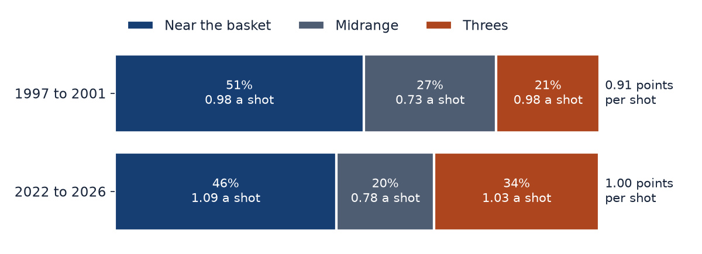
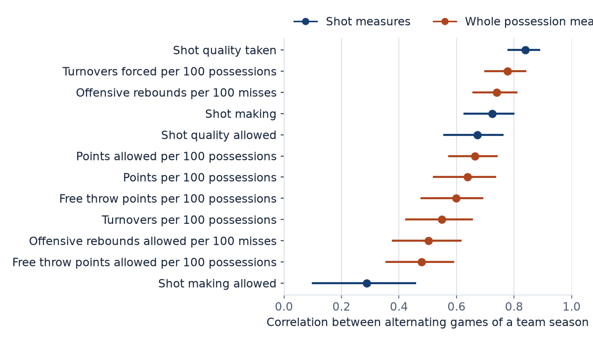
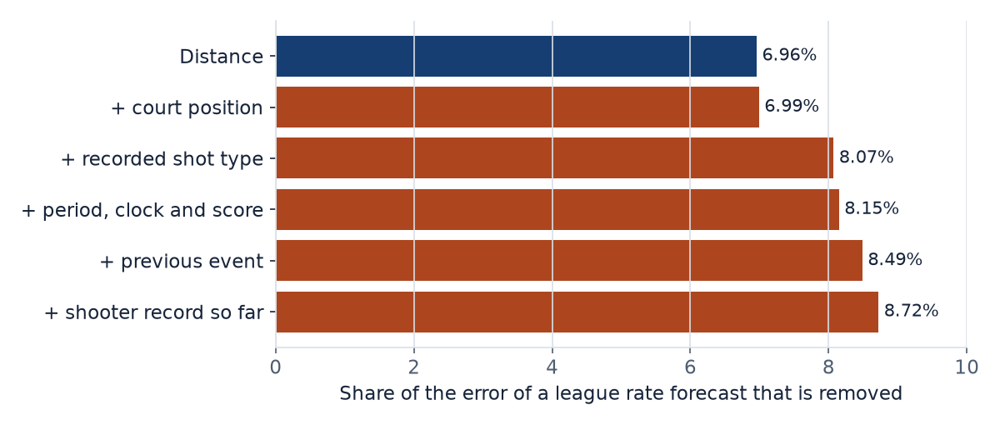
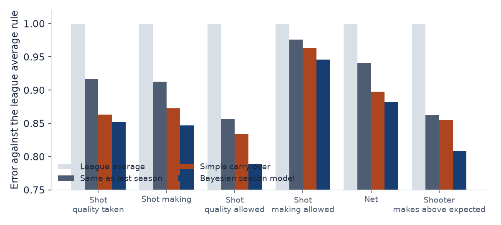

# What the public shot record can tell a WNBA team

Kevin Yamada, University of Toronto. Written 24 November 2026.

The interactive atlas is at [https://kevinyamada.github.io/wnba-shot-atlas/](https://kevinyamada.github.io/wnba-shot-atlas/). Every number in this report is read from a results file in this repository by `research/public_atlas/write_report.py`.

## Summary

- **The record.** 902,770 field goal attempts from 30 WNBA seasons, 1997 to 2026, recounted from the raw public files by code that shares nothing with the build. 811,678 have a usable court location.
- **The league changed its shots.** Threes rose from 21% to 34% of attempts and points per shot from 0.91 to 1.00. Over the whole span most of the rise came from scoring more in the same areas. Over the last ten seasons 81% of it came from where teams shoot.
- **A team controls where it shoots more than anything else.** Between alternating games of a season, the quality of the shots a team takes repeats at 0.84. Opponents' shot making against a defence repeats at only 0.29.
- **Shooters differ, and pooling is needed to see it.** True shot making skill spreads by about 3.9 makes per 100 shots between players. A pooled estimate improved forecasts of the next season by 0.23%. The raw margin made them worse.
- **Distance is hard to beat, and the reason is chance.** Everything else in the record lowers shot forecast error by 1.9% beyond distance alone.
- **Predictions for 2027 are written down.** A Bayesian season model beat simpler rules on past seasons for every measure, and its 95% ranges held 93% to 97% of outcomes.

## Questions

The project asks what a team could learn from data that anyone can download. Four questions organise it.

1. Where do teams and players shoot, and what are those shots worth?
2. Is a team getting good shots or making hard ones, and what does its defence allow?
3. Which of those numbers reflect something a team does, and which are mostly luck?
4. What can be said about next season before it is played?

## Data

Shots come from the wehoop releases of WNBA Stats (1997 to 2001) and ESPN (2002 to 2026), pinned by checksum. The explorer counts 902,770 regular season and playoff attempts, 389,257 makes and 859,086 field goal points. 89,631 attempts have no usable location, almost all of them shots recorded exactly at the basket through 2010. Play by play from WNBA Stats gives the order of events for possession work.

An independent recount reads the raw files directly and is compared with every published total, including the live site. It found three errors that are now corrected: one team whose 2002 shots carried an ID the schedule did not list, 41 made baskets filed under labels such as turnover, and a mislabelled group of shots with no team. The corrections and what remains open are in the [pipeline notes](research/public_atlas/README.md).

## Methods

**League expected points.** Each shot gets an expected number of field goal points from its distance, its side of the three point line and its recorded shot type. The curve for a season is learned from the three regular seasons before it. It never sees the team or the shooter, so it can serve as a neutral yardstick. Distance and line side lower squared error by 3.2% against the league average. Shot type adds 0.13%.

**Pooling.** A team or player margin is an observed value plus noise of known size. True margins are treated as normal around the league average, with a spread estimated by maximum likelihood. The pooled estimate keeps the share of the observed margin that the spread can explain, and the 95% interval comes from the resulting normal posterior.

**Four team measures.** Shot quality is the expected points of the shots. Shot making is the points scored above expectation. Both are measured for the shots a team takes and the shots it allows. A model that estimates every offence and defence together from single games adjusts for opponents, for the shot measures and the whole possession measures alike. The schedule is nearly balanced, so the adjustment is small: adjusted and unadjusted values correlate at 0.99 or more.

**What repeats.** Each team season is split into alternating games by date and the two halves are compared. A measure that matches across halves reflects something the team does.

**Whole possessions.** For complete possessions rebuilt from the play by play, the study counts points, turnovers, offensive rebounds per miss and free throw points, for each team and against it.

**Shooters.** The expected make chance of each shot comes from distance and shot type in the three seasons before. A player is compared with what an average shooter would make from the same shots, overall and by court area.

**Forecast tests.** Every forecast is fitted on earlier seasons and scored on later ones, against the simplest sensible alternative, with intervals from resampling whole games. All seasons through 2026 have been examined, so these are historical tests.

**Bayesian models for prediction.** A season model gives each team and shooter a true level that drifts from year to year. A normal belief is updated on every past season and carried forward. A spatial model puts a Gaussian field with Matern covariance on a triangle mesh of 841 nodes over the court, with a smooth curve in distance as its mean, and gives the make chance at every spot with a credible range.

## Results

### The league changed its shots

Bar width is the share of attempts from each area. Teams traded midrange shots for threes while scoring more near the basket.

### What a team controls

| Measure | Repeats between alternating games | 95% interval | Repeats the next season |
| --- | ---: | ---: | ---: |
| Shot quality taken | 0.84 | 0.78 to 0.89 | 0.45 |
| Shot making | 0.72 | 0.63 to 0.80 | 0.55 |
| Shot quality allowed | 0.67 | 0.56 to 0.76 | 0.52 |
| Shot making allowed | 0.29 | 0.10 to 0.46 | 0.37 |

For a defence, the shots it allows say more than whether opponents happened to make them. Across whole possessions the most repeatable measure is turnovers forced per 100 possessions (0.78) and the least is free throw points allowed per 100 possessions (0.48).

| Whole possession measure | Repeats between alternating games | 95% interval |
| --- | ---: | ---: |
| Points per 100 possessions | 0.64 | 0.52 to 0.73 |
| Turnovers per 100 possessions | 0.55 | 0.43 to 0.65 |
| Offensive rebounds per 100 misses | 0.74 | 0.66 to 0.81 |
| Free throw points per 100 possessions | 0.60 | 0.48 to 0.69 |
| Points allowed per 100 possessions | 0.66 | 0.57 to 0.74 |
| Turnovers forced per 100 possessions | 0.78 | 0.70 to 0.84 |
| Offensive rebounds allowed per 100 misses | 0.50 | 0.38 to 0.61 |
| Free throw points allowed per 100 possessions | 0.48 | 0.36 to 0.59 |

### Teams in 2026

Shot values are points per 100 shots against the league, adjusted for opponents. The last column is points per 100 possessions scored minus allowed, free throws included.

| Team | Shot quality taken | Shot making | Shot quality allowed | Shot making allowed | Whole possessions, net |
| --- | ---: | ---: | ---: | ---: | ---: |
| Indiana Fever | +1.0 | +7.0 | +1.1 | -0.3 | +5.7 |
| Las Vegas Aces | -4.6 | +9.8 | -1.9 | +0.5 | +5.2 |
| Minnesota Lynx | +0.7 | +4.0 | +1.4 | -2.4 | +5.6 |
| New York Liberty | +1.0 | +2.5 | -0.8 | +0.2 | +2.1 |
| Dallas Wings | -4.2 | +5.6 | -1.7 | +0.0 | +4.1 |
| Golden State Valkyries | -2.9 | -0.4 | -3.2 | -2.7 | +5.6 |
| Washington Mystics | +1.6 | -4.1 | -2.0 | -1.6 | +2.3 |
| Los Angeles Sparks | +1.0 | +1.2 | +1.4 | +1.6 | -3.5 |
| Portland Fire | +0.7 | +1.2 | +0.7 | +1.9 | -4.3 |
| Chicago Sky | +3.4 | -6.3 | +2.2 | -2.5 | -3.9 |
| Phoenix Mercury | -2.3 | +0.3 | -1.9 | +3.4 | -2.9 |
| Seattle Storm | -1.6 | -4.0 | -0.8 | -1.2 | -6.0 |
| Atlanta Dream | +5.2 | -6.5 | +1.8 | +0.6 | +6.3 |
| Toronto Tempo | +1.8 | -3.5 | +3.2 | +1.9 | -7.3 |
| Connecticut Sun | -1.1 | -7.0 | +0.4 | +0.6 | -9.1 |

The two views can disagree. A team can shoot poorly and still score well per possession through offensive rebounds and free throws.

### Shooters, 2016 to 2026

| Player | Attempts | Makes per 100 shots above expectation | 95% interval |
| --- | ---: | ---: | ---: |
| Elena Delle Donne | 2,530 | +8.0 | +6.2 to +9.8 |
| Paige Bueckers | 1,232 | +7.8 | +5.3 to +10.4 |
| Brittney Griner | 3,820 | +7.7 | +6.2 to +9.2 |
| Emma Meesseman | 1,813 | +7.2 | +5.0 to +9.3 |
| Natasha Mack | 511 | +7.1 | +3.5 to +10.8 |
| Allie Quigley | 2,454 | +6.8 | +5.0 to +8.7 |
| LaToya Sanders | 464 | +6.7 | +2.9 to +10.5 |
| Nneka Ogwumike | 4,790 | +6.3 | +4.9 to +7.6 |

### Why distance is hard to beat

On 44,478 shots from the 2026 regular season, with models fitted on 2022 to 2024 and tuned on 2025:

| Information | Brier error | Drop from distance |
| --- | ---: | ---: |
| League make rate only | 0.24803 |  |
| Distance | 0.23077 |  |
| Court position | 0.23069 | 0.04% |
| Recorded shot type | 0.22801 | 1.20% |
| Period, clock and score | 0.22782 | 1.28% |
| Previous event | 0.22698 | 1.64% |
| Shooter record so far | 0.22640 | 1.90% |

A single shot either goes in or it does not. If the full model's make chances were exactly right its error would still be 0.2263. Better information can only spread predicted chances further apart: distance spreads them by 12.5 percentage points and everything recorded reaches 14.6. The files hold no defender positions, passes or movement, so the gain from tracking data cannot be measured here.

### Predicting the next season

Each season from 2019 to 2026 was predicted using only earlier seasons. Error is the root mean squared error against what was then observed.

| Measure | League average | Same as last season | Simple carry over | Bayesian season model | Inside its 95% range |
| --- | ---: | ---: | ---: | ---: | ---: |
| Shot quality taken | 2.14 | 1.96 | 1.84 | 1.82 | 95% |
| Shot making | 5.69 | 5.19 | 4.96 | 4.82 | 94% |
| Shot quality allowed | 1.59 | 1.36 | 1.33 | 1.25 | 96% |
| Shot making allowed | 3.60 | 3.51 | 3.47 | 3.41 | 93% |
| Net | 7.60 | 7.16 | 6.82 | 6.71 | 94% |
| Shooter makes above expected | 4.72 | 4.07 | 4.03 | 3.81 | 97% |

The model estimates that a shooter keeps 94% of a margin from one season to the next and a team keeps 66% of its net. Team predictions stay uncertain: the model's error on team net was 6.7 points per 100 shots against 7.6 for assuming every team is average.

The spatial mesh model did not improve on the plain distance curve. Across 246,307 past shots its error was 0.06% higher, and makes fell inside its 95% range at 92% of busy court spots. Its value is the map of credible ranges, not accuracy.

For 2027 the league prediction is 36.53 for share of shots from the three point area (range 33.28 to 39.78) and 1.02 for field goal points per shot (range 0.98 to 1.06).

### Eleven spatial methods on one question

Eleven methods were given the same task: learn the make chance at each court spot from three regular seasons and predict the next, for 2024 to 2026 (115,908 shots in 853 games). A positive change means lower error than the distance curve, and the range comes from resampling whole games.

| Method | Kind | Brier error | Change from the distance curve | 95% range |
| --- | ---: | ---: | ---: | ---: |
| Gaussian process | Bayesian field | 0.23064 | +0.09% | +0.04% to +0.14% |
| Stacked ensemble | Ensemble | 0.23064 | +0.09% | +0.05% to +0.13% |
| Simple average | Ensemble | 0.23067 | +0.07% | +0.03% to +0.12% |
| SPDE mesh with trend | Bayesian field | 0.23077 | +0.03% | -0.02% to +0.09% |
| SPDE mesh field | Bayesian field | 0.23077 | +0.03% | -0.02% to +0.09% |
| Distance curve | Baseline | 0.23085 |  |  |
| Universal kriging | Geostatistics | 0.23098 | -0.06% | -0.14% to +0.02% |
| Ordinary kriging | Geostatistics | 0.23099 | -0.06% | -0.14% to +0.02% |
| Areal CAR model | Areal data | 0.23108 | -0.10% | -0.17% to -0.02% |
| Inverse distance weighting | Interpolation | 0.23136 | -0.22% | -0.31% to -0.14% |
| League rate | Baseline | 0.24697 | -6.98% | -7.31% to -6.65% |

The best method, the Gaussian process, lowered error by 0.09%. Once distance from the rim is known, a detailed map of the court adds very little. Moran's I shows why: neighbouring cells have similar make rates (I = 0.53), the distance curve removes most of that (I = 0.07) and nothing is left after the mesh model with a trend (I = -0.08, p = 0.97).

For where shots come from, a log Gaussian Cox process scored 5.0628 in average log score per shot, against 5.0612 for reusing last season's shares of shots by cell. Lower is better, so the Cox process did not beat the simple rule. The [Methods lab](https://kevinyamada.github.io/wnba-shot-atlas/lab/) shows every surface, the variogram and the ensemble weights.

## What a team could do with this

- Judge a defence by the shots it allows, since that repeats and opponent shot making mostly does not.
- Separate an offence that gets good shots from one that makes hard ones, because the second depends more on who is shooting.
- Scout a shooter by court area with honest ranges, instead of reading a hot or cold stretch as skill.
- Look at whole possessions as well as shots. Turnovers forced and offensive rebounds are among the most repeatable things a team does.

## Limits

- These are descriptions and forecasts. None of them shows that changing a scheme or a lineup would change a number.
- The record has shot locations and event order. It has no passes, cuts, defender positions or lineups on the floor, so individual actions and defensive pressure cannot be valued.
- Shot types are assigned by scorers and may be recorded differently for makes and misses.
- Locations are whole feet, missing for about a quarter of shots before 2011, and recorded differently across providers.
- Whole possessions come only from games whose event order could be confirmed.
- No prediction knows about trades, injuries, the draft or coaching changes.

## The 2027 test

Every season used here has already been examined. The [test plan](research/public_atlas/PROSPECTIVE_2027.md) freezes the models and the data rules, records the predictions, and sets how the 2027 season will be scored once, whichever way it goes.

## Reproducing the work

The [pipeline notes](research/public_atlas/README.md) list every command. Each study has a write up beside its results:

- [Recount from the raw files](research/results/public_atlas/recount/README.md)
- [Shot mix and conversion](research/results/public_atlas/shot_mix/README.md)
- [League expected points](research/results/public_atlas/expected_points/README.md)
- [What a team controls](research/results/public_atlas/teams/README.md) and [whole possessions](research/results/public_atlas/teams/POSSESSIONS.md)
- [Shooters against expectation](research/results/public_atlas/shooters/README.md)
- [Why distance is hard to beat](research/results/public_atlas/why_distance/README.md)
- [Predictions for 2027](research/results/public_atlas/prediction_2027/README.md) and the [Bayesian court surface](research/results/public_atlas/prediction_2027/SURFACE.md)
- [Methods lab](research/results/public_atlas/methods_lab/README.md): kriging, an areal model, a Gaussian process, the mesh model and ensembles compared on one question, with variograms, Moran's I and a point pattern test
