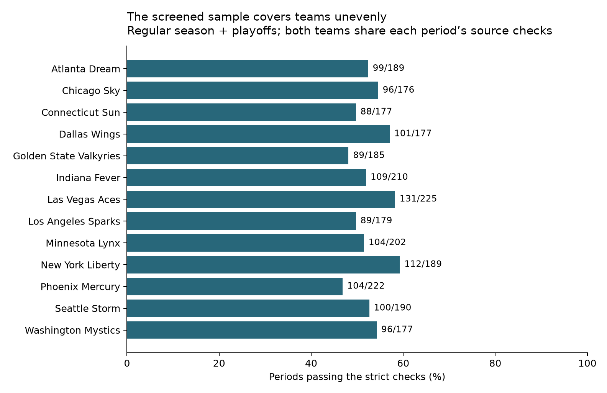
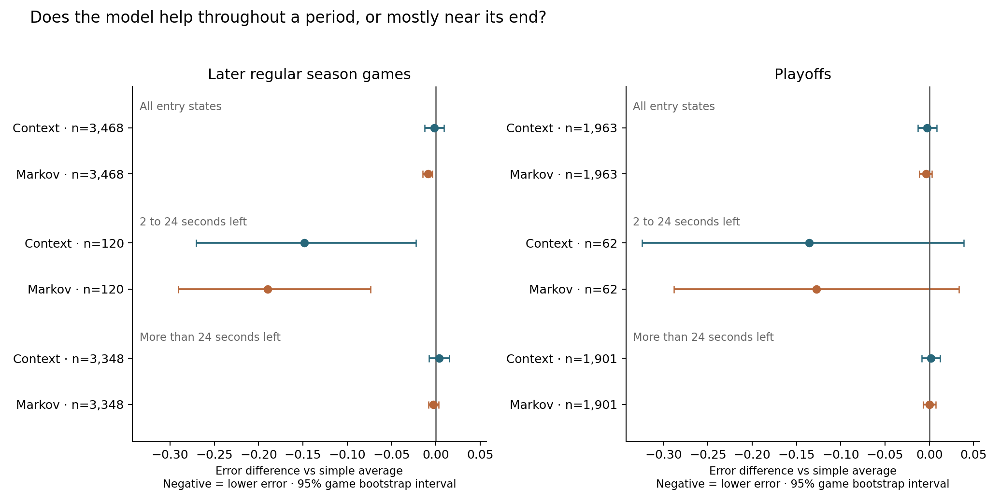
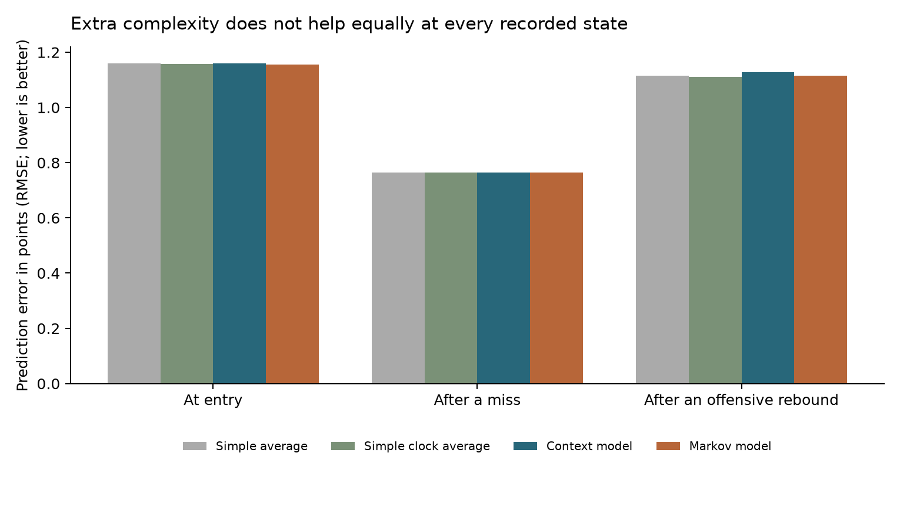

# Diagnostics before the meeting

All new calculations ran on the desktop CPU using only Data (1).zip. No models were refitted, no model settings were changed, and all five frozen inputs remain byte identical. This is an exploratory explanation of existing results, not a new test or selection exercise.

## What the data screening means

1257 periods are in the source; 662 pass the conservative period checks. Of the 595 excluded periods, **485 are excluded only because of special foul/free throw or overturned review rules**. Those events may be legitimate basketball events. Exclusion does not prove the whole period is wrong. Handling these cases more carefully is possible future work with the existing archive; their correctness must be established before changing the main sample.

Standard regular season/playoff games account for 1249 periods; 659 pass. A period may pass while an individual episode inside it still fails an ownership or free throw sequence check. These coverage figures therefore describe period screening, not the final fraction of official possessions retained. No official possession denominator is available. Both teams share the period label; coverage differences are not team performance rankings.



| reason | periods | events |
| --- | --- | --- |
| special_free_throw_or_foul | 404 | 40865 |
| overturned_review | 294 | 29073 |
| unvalidated_jump_winner | 59 | 5824 |
| score_snapshot_conflict | 52 | 5211 |
| cumulative_score_conflict | 51 | 5116 |

Reasons overlap; do not sum that table as if each period had exactly one reason. [Monthly coverage](results/data1/meeting/coverage_by_month.csv) and [retained/excluded period summaries](results/data1/meeting/period_comparison.csv) describe how the screened sample differs. Recorded points include ordinary and special free throws in this descriptive comparison.

## Where predictions help or fail

Only the already selected context model and the fixed Markov comparison are diagnosed against the training state mean baseline. Groups are the three existing state types, with a period clock split at 24 seconds, an existing model bin boundary. Twenty four seconds here refers to **time left in the period**, not an observed shot clock. All groups are shown; none selects a new winner. Whole games are bootstrapped 2,000 times using the original seed and paired errors. Subgroup intervals are exploratory and unadjusted for multiple comparisons. They do not cover uncertainty in inferred possession boundaries.



| split | clock_group | model | states | model_rmse | baseline_rmse | mse_difference | lower | upper |
| --- | --- | --- | --- | --- | --- | --- | --- | --- |
| test | all | Context boosting EPV | 3468 | 1.1597 | 1.1604 | -0.0016 | -0.0128 | 0.0091 |
| test | all | Markov EPV | 3468 | 1.1565 | 1.1604 | -0.0090 | -0.0147 | -0.0037 |
| test | 2_to_24_seconds | Context boosting EPV | 120 | 1.0762 | 1.1430 | -0.1482 | -0.2707 | -0.0222 |
| test | 2_to_24_seconds | Markov EPV | 120 | 1.0568 | 1.1430 | -0.1896 | -0.2910 | -0.0736 |
| test | over_24_seconds | Context boosting EPV | 3348 | 1.1626 | 1.1610 | 0.0036 | -0.0075 | 0.0150 |
| test | over_24_seconds | Markov EPV | 3348 | 1.1599 | 1.1610 | -0.0025 | -0.0083 | 0.0032 |
| playoffs | all | Context boosting EPV | 1963 | 1.1554 | 1.1564 | -0.0023 | -0.0131 | 0.0085 |
| playoffs | all | Markov EPV | 1963 | 1.1548 | 1.1564 | -0.0036 | -0.0110 | 0.0031 |
| playoffs | 2_to_24_seconds | Context boosting EPV | 62 | 1.0822 | 1.1432 | -0.1358 | -0.3243 | 0.0389 |
| playoffs | 2_to_24_seconds | Markov EPV | 62 | 1.0860 | 1.1432 | -0.1275 | -0.2881 | 0.0334 |
| playoffs | over_24_seconds | Context boosting EPV | 1901 | 1.1577 | 1.1568 | 0.0021 | -0.0084 | 0.0123 |
| playoffs | over_24_seconds | Markov EPV | 1901 | 1.1570 | 1.1568 | 0.0004 | -0.0071 | 0.0074 |



Different state types have different outcome distributions, so error differences between state types do not rank their difficulty or the causal value of an action. Compare models within the same state type and sample. [All subgroup results](results/data1/meeting/model_by_stage_clock.csv) include validation, later regular games and playoffs; [prediction spread](results/data1/meeting/prediction_spread.csv) shows how much the fixed predictions vary. Variation in predictions alone is not evidence of accuracy.

## Interpretation and next work

The current result remains an audited prototype with uncertain overall improvement for the validation selected model. The most useful next work is to explain the model's errors and improve supported event handling before paying for more model searches. More special case handling can potentially retain additional current archive periods, but cannot create the unrecorded passes and movement required for spatial action valuation. A genuinely new season is still needed for a fresh benchmark.

The [plain English meeting brief](MEETING_BRIEF.md) separates completed work, provisional findings, and concrete requests. The [run receipt](results/data1/meeting/diagnostics_receipt.json) records source and frozen input hashes. Final checks are saved in [verification](results/data1/meeting/final_verification.json) after publication.

## Can a simple clock rule explain the gain?

One additional diagnostic baseline uses only recorded state type and the existing six period clock bins. It estimates training bin means, shrunk with a fixed 50 observation state type prior. It is fitted only through August 9. No settings are tuned against validation or later results. Its design follows the preceding diagnosis on already examined data, so it is explicitly exploratory and does not replace the originally selected model. The existing fitted models and published website data remain unchanged.

| split | model | states | rmse | mae |
| --- | --- | --- | --- | --- |
| validation | Stage mean | 3554 | 1.1742 | 1.1125 |
| validation | Simple clock average | 3554 | 1.1704 | 1.1068 |
| validation | Context boosting EPV | 3554 | 1.1675 | 1.1004 |
| validation | Markov EPV | 3554 | 1.1702 | 1.1035 |
| test | Stage mean | 3468 | 1.1604 | 1.1033 |
| test | Simple clock average | 3468 | 1.1575 | 1.0987 |
| test | Context boosting EPV | 3468 | 1.1597 | 1.0962 |
| test | Markov EPV | 3468 | 1.1565 | 1.0948 |
| playoffs | Stage mean | 1963 | 1.1564 | 1.0981 |
| playoffs | Simple clock average | 1963 | 1.1547 | 1.0956 |
| playoffs | Context boosting EPV | 1963 | 1.1554 | 1.0938 |
| playoffs | Markov EPV | 1963 | 1.1548 | 1.0936 |

Here differences compare each existing model with the simple clock average. Negative favours the existing model. Both the selected context model and Markov intervals include zero in later regular games and playoffs, so neither establishes an additional entry state improvement beyond this simple clock rule on these reused samples.

| split | model | mse_difference | lower | upper |
| --- | --- | --- | --- | --- |
| test | Stage mean | 0.0068 | 0.0033 | 0.0105 |
| test | Context boosting EPV | 0.0052 | -0.0053 | 0.0157 |
| test | Markov EPV | -0.0022 | -0.0070 | 0.0022 |
| playoffs | Stage mean | 0.0040 | 0.0003 | 0.0074 |
| playoffs | Context boosting EPV | 0.0017 | -0.0073 | 0.0105 |
| playoffs | Markov EPV | 0.0003 | -0.0055 | 0.0054 |

[Training bin values](results/data1/meeting/clock_baseline_training.csv), [settings receipt](results/data1/meeting/clock_baseline_receipt.json), and [all comparisons](results/data1/meeting/clock_baseline_comparisons.csv). The diagnostic recipe is in `meeting_clock_baseline.py`; it adds one inexpensive training only baseline, not a new search.

## Reproduce on the desktop

From the existing VS Code checkout after the main possession study:

```powershell
$env:PYTHONUTF8='1'; $env:PYTHONIOENCODING='utf-8'
py -3.13 research/meeting_clock_baseline.py
py -3.13 research/meeting_diagnostics.py --source "$env:USERPROFILE/Downloads/Data (1).zip"
py -3.13 research/verify_meeting_diagnostics.py --source "$env:USERPROFILE/Downloads/Data (1).zip" --live
```

The last command checks published files and is run after publication. No Modal invocation or external basketball download is part of these commands.
