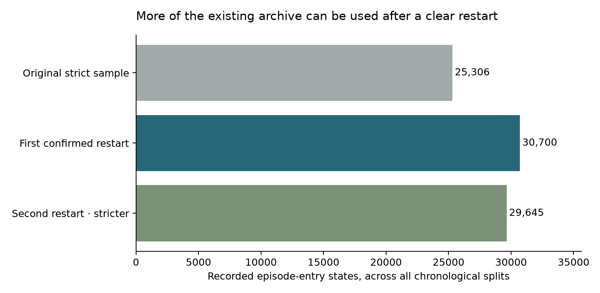
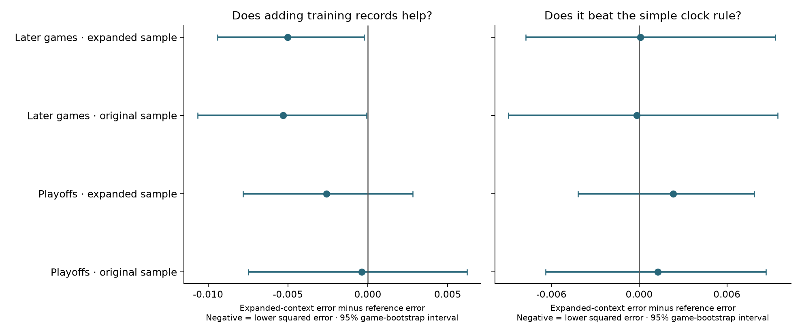
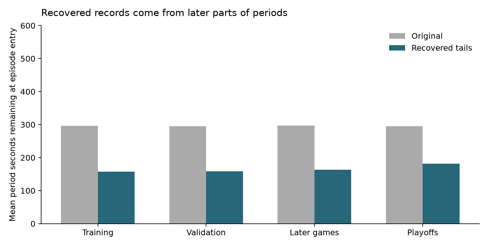

# Recovering ordinary event sequences from Data (1)

This is a conservative extension of the existing event-based possession-value prototype. It adds **5,394 recorded episode-entry states**, bringing the total from **25,306 to 30,700** (21.3% more). It uses no new basketball data and no paid GPU work. Original source rows, original model weights, original predictions, and `assets/data.json` remain unchanged.

## What changed

The original screening excluded a whole period if it contained any special-foul/free-throw or overturned-review event. Of 595 excluded source periods, 485 had only those soft exclusions. One is out of the standard-game scope, leaving **484 candidate periods**. Hard score, ordering, clock and unknown-jump-winner exclusions remain in place.

We now exclude the hazardous sequence and use only a clearly observed **tail after the final hazard**. A restart requires an ordinary missed field goal after that hazard, an opposite-team defensive rebound at a strictly lower period clock, that team's next recorded offensive action as corroboration, and an episode anchored at that rebound by the original parser. A second policy waits for a second such restart. No special free throw is treated as an ordinary automatic transfer, and no ambiguous right to possession is guessed. Special-point rewards remain in the separate ledger.

The first policy has a supported restart in 367 periods and adds usable states in **365**. All individual episode flags for unexplained transfers, incomplete free throws or uncertain ownership remain exclusions. A restart can exist while all following episodes still fail those checks. The stricter second policy adds **4,339 entry states**; its full state set is a subset of the first policy. These are partial-period tails, not recovered full quarters or official possession counts.



## Evidence, rather than silent correction

The [complete hazard catalog](results/data1/recovery/hazard_catalog.csv) records every affected source row. The [case index](results/data1/recovery/source_case_index.csv) covers every observed hazard type with a deterministic source example; the [selected event snippets](results/data1/recovery/source_case_events.csv) show the recorded clocks, teams, event types and scores around hazards and restarts. Cases with no supported restart remain excluded. A case's selected hazard may precede another hazard in that period; the rule always waits until after the **last** one. These examples and synthetic tests validate handling and provenance, not an official interpretation of every overturned call.

All 624 game/team final scores, all ordinary episode rewards, the 299 separately audited special free-throw points, and retained source score margins are checked independently. All selected features and targets are copied from the frozen event reconstruction without relabelling. Future episode labels, final quality flags and restart eligibility never enter model predictors. Eligibility itself uses retrospective source completeness; it is not a live availability guarantee.

## Fixed-setting CPU comparisons

Training still ends August 9, 2025. The original context settings (300 Poisson-loss histogram trees, depth 3, L2 penalty 100, learning rate 0.04, minimum leaf 100), Markov alpha 1, and simple-clock prior strength 50 are fixed before recovery scoring. The first policy trains on 31,582 states; the second on 30,522. No new parameter search or winner selection is performed. The CPU fits and evaluation took 56.2 seconds. The original primary shot and EPV comparisons remain frozen.

“Frozen” means fitted on the original strict training subset; “expanded” means fitted with the additional qualified training tails using the same settings. Each row within a chosen policy, stage, split and evaluation cohort uses identical state keys and labels. Original-only evaluation isolates the training effect on unchanged cases; recovered-only evaluation describes the added cases. Neither creates a fresh season test.

| split | model | states | games | rmse | mae |
| --- | --- | --- | --- | --- | --- |
| test | Frozen average | 4227 | 42 | 1.162649 | 1.103365 |
| test | Expanded average | 4227 | 42 | 1.162611 | 1.103591 |
| test | Frozen clock | 4227 | 42 | 1.158319 | 1.096805 |
| test | Expanded clock | 4227 | 42 | 1.158100 | 1.096465 |
| test | Frozen context | 4227 | 42 | 1.160521 | 1.094498 |
| test | Expanded context | 4227 | 42 | 1.158351 | 1.093014 |
| test | Frozen Markov | 4227 | 42 | 1.157962 | 1.092919 |
| test | Expanded Markov | 4227 | 42 | 1.157892 | 1.093385 |
| playoffs | Frozen average | 2438 | 24 | 1.153725 | 1.093577 |
| playoffs | Expanded average | 2438 | 24 | 1.153733 | 1.093854 |
| playoffs | Frozen clock | 2438 | 24 | 1.150516 | 1.088822 |
| playoffs | Expanded clock | 2438 | 24 | 1.150287 | 1.088439 |
| playoffs | Frozen context | 2438 | 24 | 1.152649 | 1.088561 |
| playoffs | Expanded context | 2438 | 24 | 1.151528 | 1.088223 |
| playoffs | Frozen Markov | 2438 | 24 | 1.150826 | 1.086529 |
| playoffs | Expanded Markov | 2438 | 24 | 1.150239 | 1.086074 |

For the expanded context model, the following paired differences use 2,000 whole-game bootstrap samples. Negative favours expanded context. Intervals describe uncertainty conditional on the chosen reconstructed subset, and do not cover boundary uncertainty, selection bias or a new season.

| split | baseline | mse_difference | lower | upper |
| --- | --- | --- | --- | --- |
| test | Frozen clock | 0.000074 | -0.007767 | 0.009303 |
| test | Frozen context | -0.005033 | -0.009421 | -0.000236 |
| playoffs | Frozen clock | 0.002330 | -0.004190 | 0.007874 |
| playoffs | Frozen context | -0.002583 | -0.007808 | 0.002822 |

On the later regular benchmark, expanded context improves on frozen context on both the expanded sample and unchanged original sample. Its comparison with the frozen simple-clock model includes zero. Playoff differences also remain uncertain. The supported conclusion is a larger auditable sample and a modest conditional refit improvement, **not** a demonstrated general advantage over a simple clock rule. The [stricter-policy sensitivity](results/data1/recovery/policy_sensitivity.csv) compares refits on identical shared states rather than comparing errors from different samples.



## Coverage and interpretation

Recovered tails have less period time remaining on average. They do not represent a random sample of the excluded quarters. Average outcomes, team coverage and prediction difficulty can therefore change with the sampling rule. The earlier “485 exclusions” finding was a scope diagnosis, not a promise that all those periods could be used. No model is promoted by looking for the best reused-sample result.



[Cohort counts and means](results/data1/recovery/recovery_cohorts.csv), [all metrics](results/data1/recovery/metrics.csv), [all paired intervals](results/data1/recovery/game_bootstrap.csv), [calibration](results/data1/recovery/calibration.csv), [period decisions](results/data1/recovery/recovery_periods.csv), [rule receipt](results/data1/recovery/recovery_rule_receipt.json), and [fit receipt](results/data1/recovery/fit_receipt.json) are public. Individual predictions and new model weights remain in ignored `research/data/`.

## Reproduce and final checks

Run from the desktop VS Code checkout, after the original study:

```powershell
$env:PYTHONUTF8='1'; $env:PYTHONIOENCODING='utf-8'
py -3.13 research/test_possession_recovery.py
py -3.13 research/possession_recovery.py --source "$env:USERPROFILE/Downloads/Data (1).zip"
py -3.13 research/recovery_models.py
py -3.13 research/report_recovery.py --source "$env:USERPROFILE/Downloads/Data (1).zip"
py -3.13 research/verify_recovery.py --source "$env:USERPROFILE/Downloads/Data (1).zip" --live
```

The final command runs after publication. It independently reconstructs source restart evidence, every target and feature count, unchanged original rows, chronological splits, model inference, Markov values, metrics, intervals, shared-state sensitivity, case snippets and published assets. Twelve new synthetic tests cover every hazard type, technical and retained-possession sequences, dead-ball rebounds, same-clock exclusions, unsupported restarts and hard failures; the earlier eight parser tests also remain required. [Final recovery verification](results/data1/recovery/final_verification.json).

Full spatial pass and movement valuation remains beyond this archive. This extension deliberately estimates only ordinary recorded-event tails. It does not invent pass trajectories, movement endpoints, shot clock or causal action credit.
